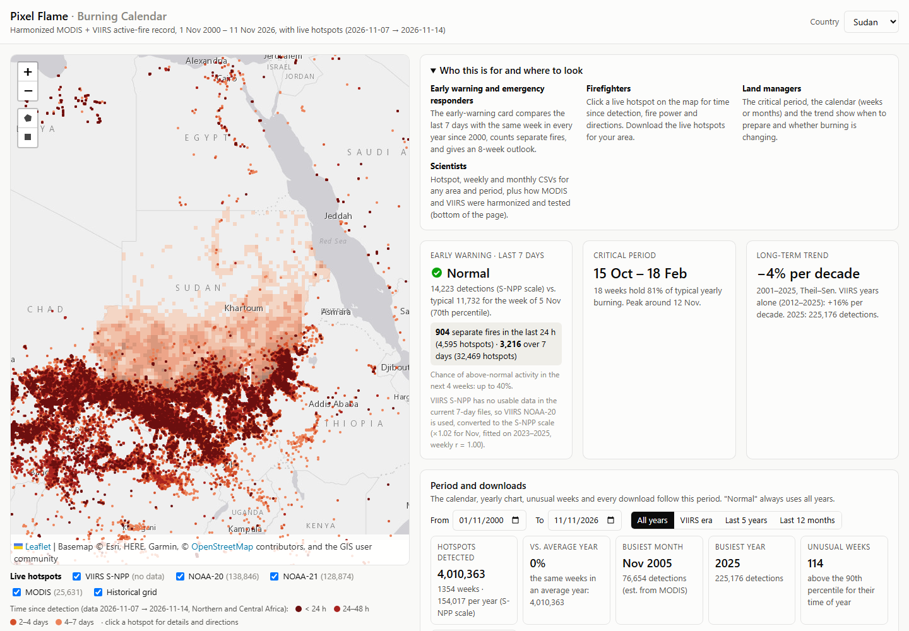

# Pixel Flame: a harmonized burning-activity calendar

**NASA Space Apps Challenge 2026: burning activity calendar.**
Pixel Flame merges more than 25 years of satellite fire detections from MODIS (2000–) and VIIRS (2012–)
into one consistent record, so the sensor of origin no longer matters. It turns that record into a
burning calendar for any area of interest, with live hotspots, early warning, an 8-week outlook and
CSV/PNG downloads.



Demo countries: **Sudan, Nigeria and Egypt**. The record runs from 1 Nov 2000 to the last complete week.

## Highlights

- **One consistent record, 2000 to today.** MODIS is converted to the VIIRS S-NPP 375 m scale with
  month-specific ratios, tested out of sample (weekly r = 0.99 for Sudan and Nigeria).
- **Robust to losing a satellite.** Days when S-NPP was down are filled from NOAA-20 or MODIS. When the
  S-NPP live feed stopped in November 2026, the early warning switched to NOAA-20 automatically
  (calibration r = 0.998).
- **Any area, any period.** Pick a country, draw a shape, or type a latitude/longitude and radius. Then
  choose dates or a preset period.
- **Burning calendar** of weeks or months × years, shown as detection counts or as anomalies against
  normal, with colour-blind-safe ramps checked with a colour-vision validator.
- **Early warning:** the last 7 days compared with the same week in every past year, plus the number of
  separate fires in the last 24 hours and an 8-week outlook with backtested uncertainty.
- **Downloads:** every individual hotspot in the area and period, weekly and monthly analytics, live
  hotspots (CSV), and any chart as PNG.
- **For four audiences:** emergency responders, firefighters, land managers and scientists. A short guide
  in the app tells each where to look.

## Quick start: view the app

[](https://codespaces.new/AhmHashem/Pixel_Flame?quickstart=1)

**In the browser, no download:** click the button above, then **Create codespace**. After about a minute
the app opens in a new tab. If the browser blocked that tab, open the **Ports** panel and click the link
next to *Pixel Flame app*.

**On your own computer:** the `web/` folder is a static site and already contains the built data, so no
build step is needed.

```powershell
python -m http.server 8765 --directory web
```

Then open <http://localhost:8765>. Opening `index.html` directly from disk won't work: browsers block the
data files on `file://` pages.

## Rebuild the data (optional)

```powershell
pip install -r requirements.txt
python pipeline/download.py     # FIRMS yearly archives (~1.3 GB, cached), current year via the API, live 7-day files
python pipeline/build.py        # clean, find outages, grid, harmonize, validate -> web/data
```

The current year needs a free [FIRMS MAP_KEY](https://firms.modaps.eosdis.nasa.gov/api/map_key/). Put it in
`firms_map_key.txt` in the project root or in the `FIRMS_MAP_KEY` environment variable. `firms_map_key.txt`
is git-ignored: **never commit the key or put it in `web/`.** Without a key, the record ends with the last
yearly archive.

- To refresh only the live layer: `python pipeline/download.py --nrt-only`, then `python pipeline/build.py`.
- To add a country: add it to `COUNTRIES` and `COUNTRY_ISO3` in `pipeline/config.py`, then download and
  build.

## Project structure

```
pipeline/
  config.py      settings: countries, years, fit windows, FIRMS URLs
  download.py    FIRMS archives, current year via the area API (clipped to borders), live 7-day files
  geo.py         country borders (Natural Earth 1:10m) for clipping API results
  build.py       cleaning, outage detection, gridding, harmonization, validation, export
web/
  index.html     the app (Leaflet map + ECharts charts, no build step)
  app.js         UI: area and period selection, calendar, charts, downloads
  analysis.js    pure analytics: baselines, anomalies, critical period, trend, outlook, fire clusters
  style.css      layout, light/dark themes, validated colour ramps
  data/          built data: one JSON per country, live hotspots, per-year hotspot files
docs/            screenshot
.devcontainer/   GitHub Codespaces setup (serves web/ on port 8765)
```

## Method

1. **Current year.** The FIRMS area API provides the current year. It uses standard processing where NASA
   has published it and near-real-time processing after that. Each country's bounding box is fetched in
   5-day requests and clipped to Natural Earth borders. Two checks show this matches FIRMS's own country
   files:

   - 100% of the 2025 archive detections fall inside these borders.
   - For 1–5 Jan 2025, the API plus clip matched the archive detection for detection, with zero extra and
     zero missing.

   The calendar stops at the last complete week.
2. **Clean.** Keep vegetation fires only (FIRMS `type` 0), MODIS confidence ≥ 30, and VIIRS nominal/high.
   Near-real-time rows have no `type`, so known static heat sources (gas flares, industry, volcanoes) from
   the archive are masked out of them.
3. **Find sensor outages.** A day counts as an S-NPP outage when S-NPP reports nothing, or less than 30% of
   what NOAA-20 (or, before 2023, MODIS) implies, while the other satellite clearly sees fires. 69 such days
   were found from 2012 to 2026, for example 3–6 Nov 2024, which is peak season.
4. **Grid.** Put detections on a 0.25° grid with 52 weeks per year. The 8–9-day last week is scaled to 7
   days.
5. **Harmonize to the VIIRS S-NPP scale.** Every step uses month-specific ratios, shrunk toward the
   all-year ratio in sparse months. Weeks touched by an outage are left out of every fit.

   - Terra-only years (2000–2002) are scaled to Terra+Aqua. The ratio is fitted on 2003–2011.
   - MODIS is converted to S-NPP. The ratio is fitted on the 2012–2020 overlap, before Terra/Aqua orbit
     drift.
   - NOAA-20 is converted to S-NPP. The ratio is fitted on 2023–2025.
   - S-NPP outage days are filled from NOAA-20, or from MODIS before 2023.
6. **Validate.** For MODIS → VIIRS, fit on 2012–2017 and predict VIIRS for 2018–2020 from MODIS alone.

   | Country | Weekly r | Log r | Bias | Grid-cell × month r | NOAA-20 → S-NPP weekly r |
   | ------- | -------- | ----- | ---- | ------------------- | ------------------------ |
   | Sudan   | 0.99     | 0.97  | +0%  | 0.80                | 0.998                    |
   | Nigeria | 0.99     | 0.98  | +3%  | 0.86                | 0.998                    |
   | Egypt   | 0.57     | 0.54  | −36% | 0.17                | 0.962                    |

   Egypt's burns are mostly small agricultural fires that MODIS rarely sees, so its pre-2012
   reconstruction is flagged as low quality in the app. The hotspot CSV agrees with the calendar to within
   0.74% (Sudan, 2019).
7. **Analyse in the browser for any area and period.**

   - Weekly and monthly percentile baselines. Monthly totals add up exactly to the yearly total.
   - Critical period: the shortest run of weeks holding 80% of typical burning.
   - Anomalies: weeks above the 90th percentile.
   - Theil–Sen trend.
   - Fire clusters: hotspots within about 1 km are merged.
   - 8-week outlook: seasonal cycle plus an AR(1) anomaly term, with 80% ranges from the area's own
     backtests.

## Data and credits

- [NASA FIRMS](https://firms.modaps.eosdis.nasa.gov/): MODIS Collection 6.1 and VIIRS 375 m (S-NPP,
  NOAA-20, NOAA-21) active fire products. Yearly country archives, area API and near-real-time 7-day
  files.
- [Natural Earth](https://www.naturalearthdata.com/) 1:10m admin-0 country borders (public domain).
- [Leaflet](https://leafletjs.com/) and [Leaflet.draw](https://github.com/Leaflet/Leaflet.draw) for the
  map, [Apache ECharts](https://echarts.apache.org/) for the charts, and
  Esri Light/Dark Gray Canvas basemaps (Esri, HERE, Garmin,
  [OpenStreetMap](https://www.openstreetmap.org/copyright) contributors and the GIS user community).
  These tiles need no API key or Referer, so the map also works inside GitHub Codespaces.

## Known limits

- Recent months use near-real-time processing until NASA publishes standard processing. Rebuild then to
  pick it up.
- Area statistics use 0.25° cells, so custom area edges are approximate (~25 km). The hotspot CSV uses the
  exact area.
- A hotspot is the centre of a 375 m or 1 km pixel. The directions link points there, not to a verified
  fire front.
- The live layer is a snapshot taken at build time. Re-run the pipeline to refresh it.
